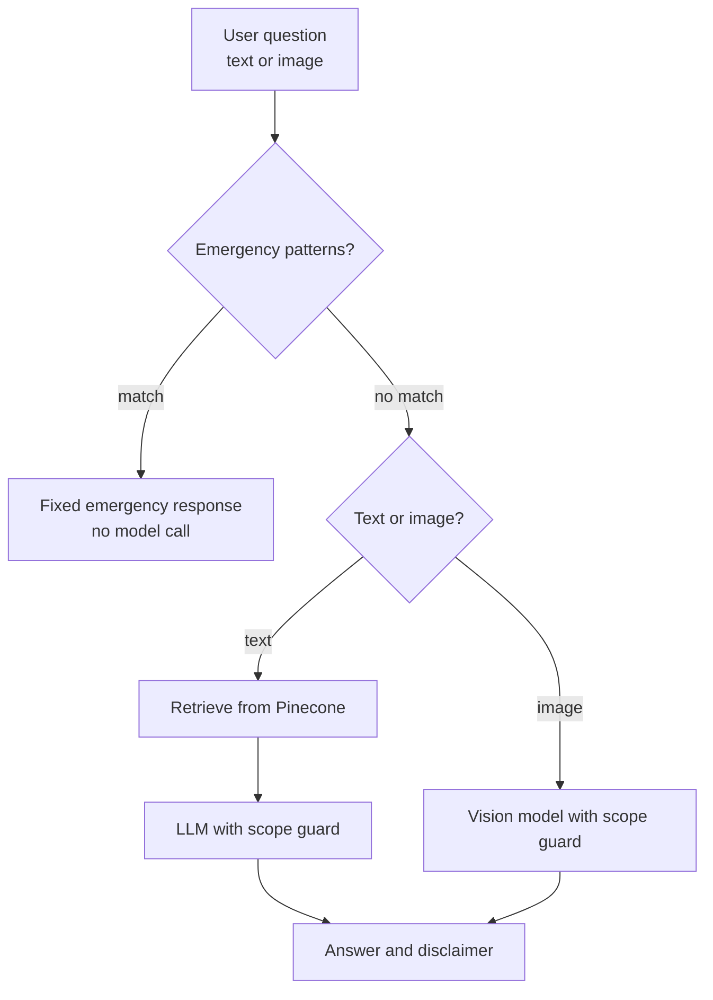

# Medical Information Chatbot with Safety Guardrails

A multimodal chatbot that answers general medical questions, built with LangChain and OpenAI models: text questions use retrieval (RAG) over reference documents in a Pinecone index, and image questions use a vision model. Safety is built into the code path, not left to the prompt: emergencies are caught before any model call, and every answer stays within general information.

> **This chatbot provides general medical information only. It is not a substitute for professional medical advice, diagnosis or treatment, and it is not equipped to handle emergencies.**

## Highlights

- **Emergency detection before the LLM.** Every input is checked against red-flag patterns (chest pain, difficulty breathing, overdose, anaphylaxis, suicidal language and more). A match skips retrieval and the model entirely and returns a fixed message pointing to emergency services, so no prompt can talk the model past it.
- **Scope guard.** Answers describe general information from the retrieved sources only. The model is instructed never to diagnose, prescribe or give personal dosing advice, and to say so when the sources don't cover a question.
- **Text and image questions.** A vision-capable model describes the visible features of a medical image, such as a rash, under the same guardrails and without diagnosis-style language.
- **Disclaimer on every answer**, so the informational nature of the tool is never implicit.
- **Managed vector search.** Reference documents are embedded with OpenAI's text-embedding-3-small and stored in a Pinecone serverless index, created on first run.

## How it works



## Project structure

```
src/
  guardrails.py    Emergency detection, scope-guard prompt and disclaimer, shared by text and image
  ingest.py        Loads .txt, .md and .pdf reference documents and chunks them
  vectorstore.py   Embeds chunks and upserts them into a Pinecone serverless index
  qa_chain.py      Text Q&A over retrieved context (gpt-4o-mini by default)
  vision.py        Image Q&A with a vision-capable model
main.py            Command-line entry point: ingest, ask, ask-image, chat
tests/             Unit tests for the guardrails and ingestion
```

## Getting started

Requires Python 3.11 or 3.12, an OpenAI API key and a Pinecone API key.

```bash
python -m venv venv
source venv/bin/activate          # Windows: venv\Scripts\activate
pip install -r requirements.txt
```

Set `OPENAI_API_KEY` and `PINECONE_API_KEY` in a `.env` file or your shell.

## Usage

```bash
# 1. Put reference documents (.txt, .md, .pdf) in docs/, then ingest them
python main.py ingest --docs-dir docs

# 2. Ask a text question
python main.py ask --question "What are common symptoms of the flu?"

# 3. Ask about an image
python main.py ask-image --image rash.jpg --question "What might cause this?"

# 4. Or chat interactively
python main.py chat
```

## Tests

```bash
pytest
```

The most important tests exercise the emergency detector in both directions: emergency phrasings it must catch (false negatives) and routine medical questions it must let through (false positives). Ingestion has its own tests. None of them need an API key.

## Limitations

- **Emergency detection is keyword-based.** It's a safety floor, not a triage system. It won't catch every phrasing, typo or language, so any real deployment needs human oversight as well.
- **The scope guard relies on the model following instructions.** It reduces diagnosis-style answers but can't rule them out.
- **Answers are only as good as the ingested sources.** Use accurate, properly licensed medical reference material.
- **Not for clinical use.** A qualified reviewer should sign off on the guardrails before any real-world use.

## Roadmap

- Fuzzy and multilingual emergency detection
- A red-team prompt set to measure guardrail misses over time
- Citations that link each answer to its source passages
